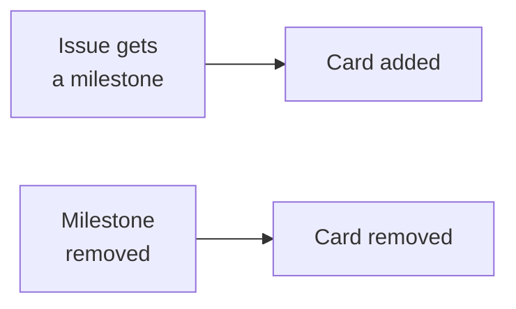

# Milestone Project Sync

Keep a GitHub Project board holding exactly the issues that have a milestone. An issue gets a card
when it gets a milestone, and loses it when the milestone goes. Point any number of repositories at
one board, across users and organizations.



GitHub's built-in auto-add workflow can't filter on milestones, which is why this exists.

## Usage

```yaml
# .github/workflows/sync-milestoned-issues-to-github-project.yml
name: 🗂️ Sync milestoned issues to GitHub Project

on:
  issues:
    types: [milestoned, demilestoned]

concurrency: project-sync-${{ github.event.issue.number }}

jobs:
  sync:
    runs-on: ubuntu-latest
    timeout-minutes: 2
    steps:
      - uses: jd-solanki/milestone-project-sync@main
        with:
          project-owner: <owner>
          project-number: <number>
          github-token: ${{ secrets.PROJECT_PAT }}
```

Take `<owner>` and `<number>` from the board's URL:
`https://github.com/users/<owner>/projects/<number>`, or `/orgs/<owner>/` for an organization's.

Creating an issue with a milestone already set fires `milestoned` too, so `opened` isn't needed.

## Token

The built-in `GITHUB_TOKEN` can't reach a project outside its repository. Create a
[classic personal access token](https://github.com/settings/tokens/new?scopes=project,repo&description=milestone-project-sync)
with these scopes:

| Scope     | Why                                                      |
| --------- | -------------------------------------------------------- |
| `project` | Adds and removes cards                                   |
| `repo`    | Reads issues in a private repository. Clear it if public |

Then store it in each repository that runs the workflow:

```shell
gh secret set PROJECT_PAT --repo <owner>/<repo>
```

For repositories in one organization, store it once: `gh secret set PROJECT_PAT --org <org> --repos <repo>,<repo>`.

## Behaviour

- **The current milestone decides.** Each run reads the issue as it is now, not the event, so
  changes that arrive out of order still settle right.
- **Removing deletes the card**, with its **Status** and other field values. An issue that gets a
  milestone again comes back as a new card.
- **New milestones only.** Issues that had a milestone before you added the workflow stay off the
  board until their milestone changes.

## Development

```shell
vp install
vp test
vp check
```

The runner executes `dist/` as committed. The pre-commit hook rebuilds it, so each commit carries
the build of its own source.
